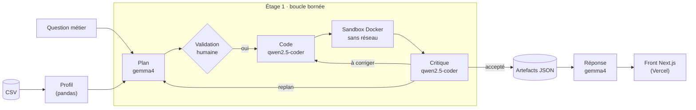

# Architecture

Un agent, pas un pipeline : la démarche est décidée en fonction de la question, avec une
boucle de critique. Deux étages, évaluables séparément, reliés par un contrat JSON.

## Patterns retenus

| Pattern | Où | Pourquoi |
|---|---|---|
| **Contract-first** | `schemas.py` (Pydantic, `extra="forbid"`) | Les deux étages ne se connaissent que par ce contrat |
| **Ports et adaptateurs** | `LLMClient` (Protocol), `DockerSandbox` | Changer de fournisseur ou de moteur d'exécution sans toucher à l'agent |
| **Fail-closed** | Sandbox | Sans Docker, on refuse d'exécuter : aucun repli sur l'hôte |
| **Redaction à la frontière** | `critic.redact_data_values`, `synthesis.summarize_for_llm` | Les valeurs de données ne retournent jamais au modèle |
| **Boucle bornée** | `AgentState.max_iterations` | Un critique jamais satisfait ne doit pas boucler |
| **Human-in-the-loop** | Validation du plan avant toute exécution | La démarche est relue avant d'exécuter du code |
| **Un modèle par rôle** | `Settings.model_for(role)` | Chaque tâche sur le modèle qui la réussit le mieux |
| **Configuration par l'environnement** | `config.py`, `.env` | Même code du poste de dev à la démo (12-factor) |
| **Flux d'événements** | `RunTrace.emit` → SSE | Observabilité du run en direct, sans couplage au front |

## Vers une data platform

Ce qui est déjà découplé et se déplace sans réécriture :

- **Données** : l'agent reçoit des chemins CSV ; remplacer par une source (SQL, objet) revient
  à fournir un autre profileur et un autre montage dans le sandbox.
- **Calcul** : le sandbox est une image Docker autonome (publiée sur GHCR) ; elle peut tourner
  sur un orchestrateur de conteneurs plutôt que sur le poste.
- **LLM** : un serveur compatible Ollama, ou un autre fournisseur derrière `LLMClient`.
- **Interface** : le front n'appelle que l'API ; il ne sait rien du reste.

Les décisions et leurs raisons sont dans [`docs/adr/`](adr/).
