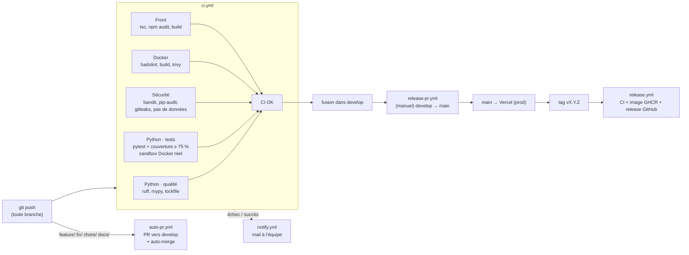

# CI/CD

Tout est dans `.github/workflows/`. Chaque action tierce est épinglée par son SHA de commit
(supply-chain) ; Dependabot propose les mises à jour chaque semaine.



## Les contrôles

| Job | Ce qu'il garantit | En local |
|---|---|---|
| Python · qualité | Format, lint, typage, `uv.lock` cohérent | `make lint typecheck` |
| Python · tests | Tests unitaires et d'isolation du sandbox, couverture ≥ 75 % | `make cov` |
| Sécurité | Pas de faille connue (Python), pas de secret dans l'historique, pas de CSV ni `.env` | `make security` |
| Docker · sandbox | Dockerfile propre, image construite, aucune faille critique corrigeable | — |
| Front · build | Types, dépendances saines, build de production | `make web` |
| **CI OK** | Tous les précédents. **Seul contrôle à exiger** dans la protection de branche | `make ci` |

## Mise en place unique (propriétaire du dépôt)

```bash
gh auth login && gh auth refresh -s workflow
./scripts/github-setup.sh --dry-run     # voir ce qui sera appliqué
./scripts/github-setup.sh               # protège main et develop, active l'auto-merge
```

Le script règle : protection de `main` et `develop` (PR obligatoire, « CI OK » obligatoire,
branche à jour, conversations résolues, pas de force-push), squash-merge, suppression des
branches fusionnées, auto-merge, droit aux Actions d'ouvrir des PR, alertes de sécurité.

## Notifications par mail

GitHub envoie déjà un mail à l'auteur d'un push dont la CI échoue (réglage personnel :
Settings → Notifications → Actions). Pour prévenir toute l'équipe, `notify.yml` envoie un
mail à chaque échec, et à chaque succès sur `develop` et `main`. Désactivé par défaut ;
l'activer dans Settings → Secrets and variables → Actions :

| Type | Nom | Exemple |
|---|---|---|
| Variable | `MAIL_NOTIFICATIONS` | `true` |
| Secret | `MAIL_SERVER`, `MAIL_PORT` | `smtp.office365.com`, `587` |
| Secret | `MAIL_USERNAME`, `MAIL_PASSWORD` | compte d'envoi (mot de passe d'application) |
| Secret | `MAIL_TO` | `equipe@exemple.com` |

## Déploiement

| Cible | Déclencheur | Comment |
|---|---|---|
| Front (Vercel) | push sur `main` | Intégration Git de Vercel, Root Directory = `web`. Un aperçu est créé par PR. |
| Image du sandbox (GHCR) | tag `vX.Y.Z` | `release.yml` → `ghcr.io/<propriétaire>/agent-data-sandbox:<version>` |
| Agent (LLM, sandbox, API) | manuel | Poste GPU : `make demo FRONT=https://…`. Voir `docs/architecture.md`. |

Le front est le seul composant qui se déploie automatiquement : l'agent tourne là où sont les
données et le GPU, par conception.
