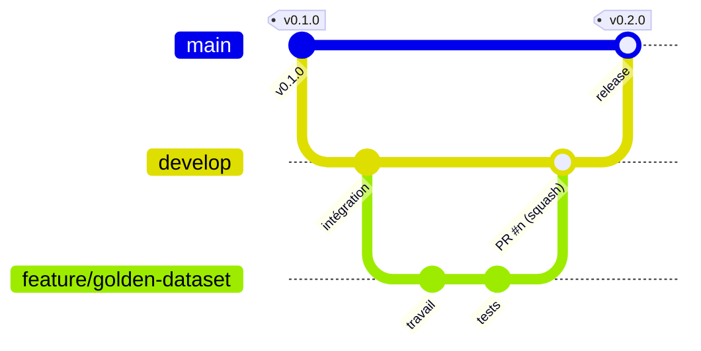

# Workflow Git

Modèle à deux branches longues et des branches de travail courtes, sur le principe de
Git Flow allégé. Tout passe par une PR relue ; la CI doit être verte avant toute fusion.



| Branche | Rôle | Part de | Fusionne vers | Protégée |
|---|---|---|---|---|
| `main` | Livrable, déployé (Vercel), tagué | — | — | oui |
| `develop` | Intégration continue du travail | `main` | `main` (release) | oui |
| `feature/<sujet>` | Une fonctionnalité | `develop` | `develop` | non |
| `fix/<sujet>` | Un bug non urgent | `develop` | `develop` | non |
| `chore/<sujet>` / `docs/<sujet>` | Outillage, documentation | `develop` | `develop` | non |
| `hotfix/<sujet>` | Bug urgent en production | `main` | `main` puis `develop` | non |

## Au quotidien

```bash
git switch develop && git pull
git switch -c feature/mon-sujet
# ... travail, petits commits ...
make ci                         # ce que fera la CI, en local
git push -u origin feature/mon-sujet
```

Le push ouvre la PR vers `develop` toute seule (`auto-pr.yml`) et active la fusion
automatique : elle part dès que « CI OK » est vert et que la relecture exigée est faite.

## Règles

- **Une PR = un sujet**, courte. Squash-merge vers `develop` : un commit propre par PR.
- **Pas de push direct** sur `main` ni `develop`.
- **Messages de commit** : une ligne, à l'impératif ou au passé, qui dit ce qui change
  (« Corrige le calcul de la couverture », « Ajoute le bloc GPU à la démo »). Pas de
  préfixe imposé, pas de trailer. Le détail va dans la PR.
- **Relecture** : un relecteur au moins avant `main` ; les fichiers sensibles (sandbox,
  critique, CI) ont des propriétaires (`.github/CODEOWNERS`).
- **Historique linéaire** sur `develop` ; `main` reçoit des fusions de release.

## Livrer une version

1. Actions → **PR de release** → saisir la version (`0.2.0`) : la PR `develop → main` s'ouvre,
   avec la liste des changements depuis le dernier tag.
2. Relire, fusionner (merge commit, pour garder la trace de la release).
3. Poser le tag : `git tag -a v0.2.0 -m "v0.2.0" && git push origin v0.2.0`.
4. `release.yml` rejoue la CI, publie l'image du sandbox sur GHCR et crée la release GitHub.
5. Vercel redéploie le front depuis `main`.
6. Remettre `main` dans `develop` si des hotfix y sont passés.

Versionnage [SemVer](https://semver.org/lang/fr/) : majeure = contrat d'artefacts cassé,
mineure = fonctionnalité, patch = correction. Le contrat d'artefacts (`schemas.py`) relie les
deux étages : le modifier est un changement à signaler.

## Hotfix

`hotfix/<sujet>` depuis `main`, PR vers `main` (la PR est ouverte automatiquement), tag patch,
puis fusion de `main` dans `develop`.
